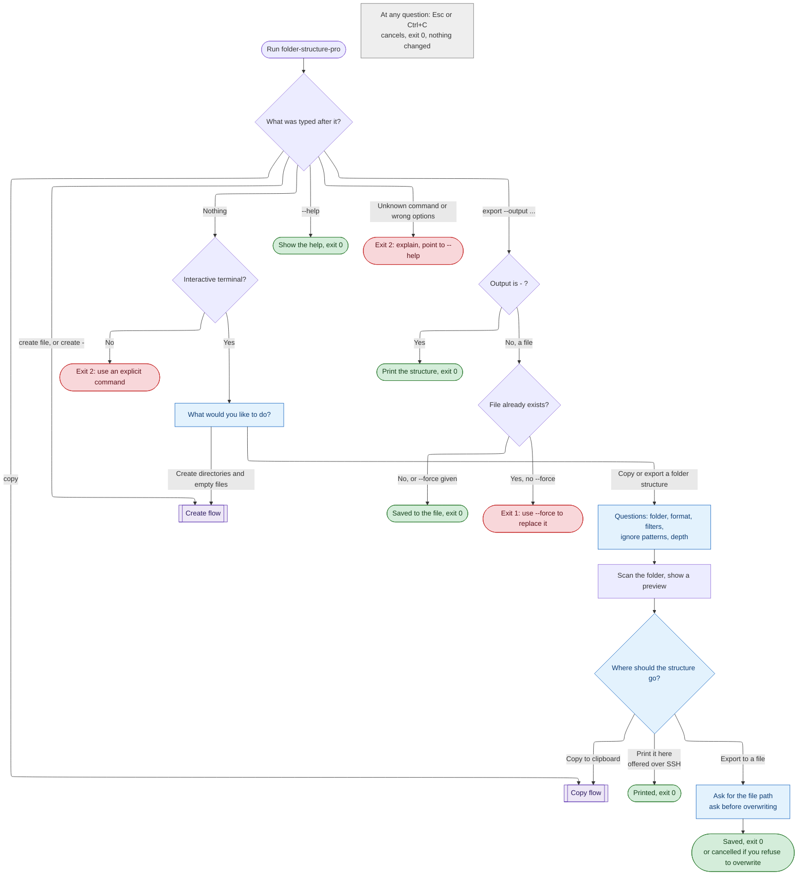
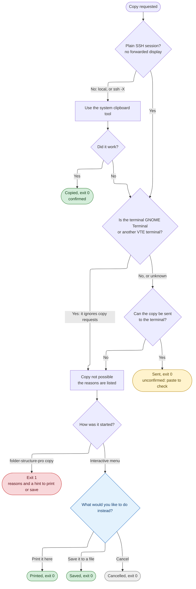
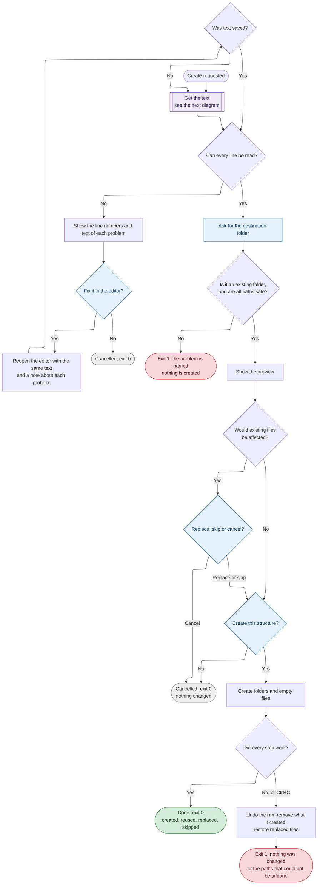
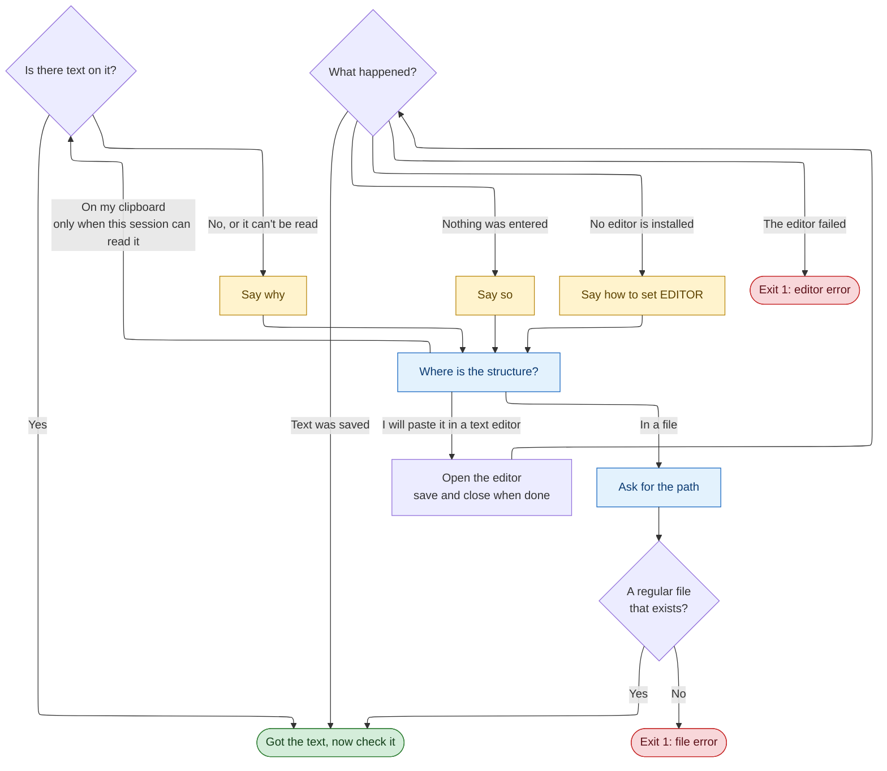

# CLI flows

What the `folder-structure-pro` CLI asks and decides, in three parts. GitHub renders the diagrams.

1. [Overview](#1-overview): everything from the top, and where each command leads.
2. [Copy flow](#2-copy-flow): what happens when the structure is copied to the clipboard.
3. [Create flow](#3-create-flow): how a structure is turned into folders and files.

| Colour | Meaning                                |
| ------ | -------------------------------------- |
| Blue   | A question the user answers            |
| Green  | Success                                |
| Yellow | Done, but the result cannot be checked |
| Grey   | Cancelled by the user, nothing changed |
| Red    | Error                                  |

Exit codes: **0** success, help, or cancelled. **1** the operation failed. **2** the command or its options were wrong.

These diagrams are written by hand from the code. When the behaviour changes, update them too.

## 1. Overview

Code: `packages/cli/src/arguments.ts` (reading the command), `packages/cli/src/cli.ts` (`runExecutable`, `runDirectCommand`, `runCli`).

## 2. Copy flow

What happens after you ask for a copy, from the interactive menu or from `folder-structure-pro copy`.

Code: `packages/cli/src/adapters/clipboard.ts` (the decisions), `packages/cli/src/adapters/nativeClipboard.ts` (the system tools), `packages/cli/src/adapters/terminalIdentity.ts` (recognising GNOME Terminal).

What the system clipboard tool is:

| Where you run it  | Tool tried                                |
| ----------------- | ----------------------------------------- |
| macOS             | `pbcopy`                                  |
| Windows           | PowerShell, then `clip.exe`               |
| WSL               | The Windows tools above                   |
| Linux, Wayland    | `wl-copy`                                 |
| Linux, X11        | `xclip`, `xsel`, then Python 3 with GTK   |
| Plain SSH session | None. The server's clipboard isn't yours. |

Good to know:

- Over plain SSH the terminal is asked first. In the interactive menu, a GNOME Terminal is recognised before the question, so "Copy to clipboard" is left out of the menu.
- After "Sent" on a Linux desktop where no tool was found, the message also suggests installing `xclip`, `xsel` or `wl-clipboard`.
- Over SSH to a macOS or Windows machine, that machine's own clipboard is never used. A copy that only reached the server is not reported as "Copied".

## 3. Create flow

What happens after **Create directories and empty files**, or `folder-structure-pro create <file or ->`. The same checks run in both. The direct command asks no questions: it needs `--yes`, and any problem stops with exit 1 before anything is created.

Code: `packages/cli/src/cli.ts` (`collectStructure`, `runStructureCreation`), `packages/core/src/structureInput.ts` (reading and checking the structure), `packages/core/src/creation.ts` (safety checks and creation), `packages/cli/src/adapters/editor.ts`.

### Getting the text

Used by the first step above. Anything that can't be used goes back to the question "Where is the structure?"

Direct command: `create -` reads the text from standard input, `create <file>` reads the file. The format (text or JSON) is detected from the content unless `--format` is given.
