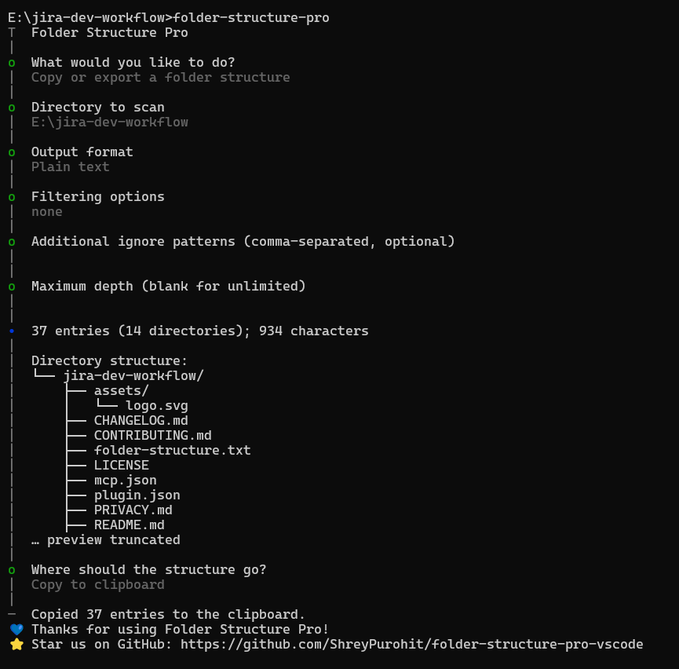
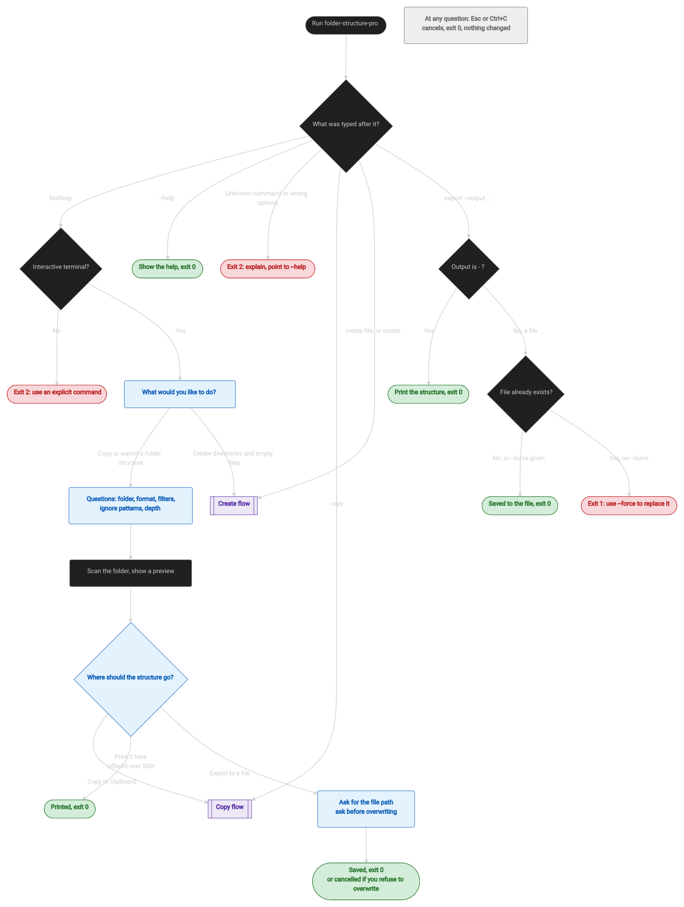
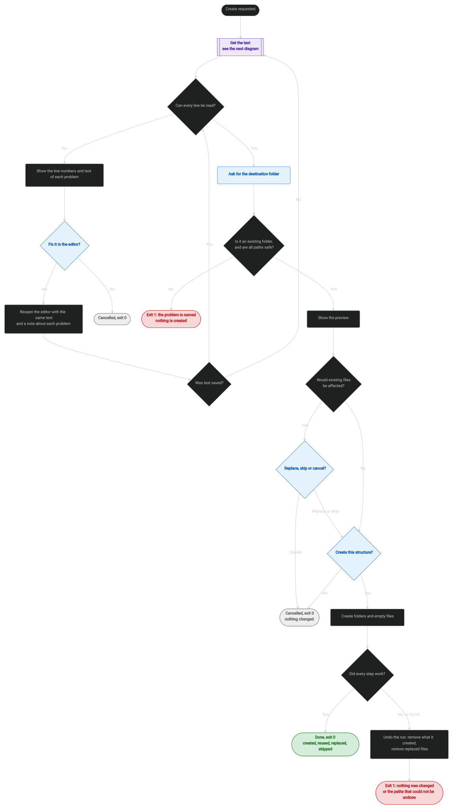
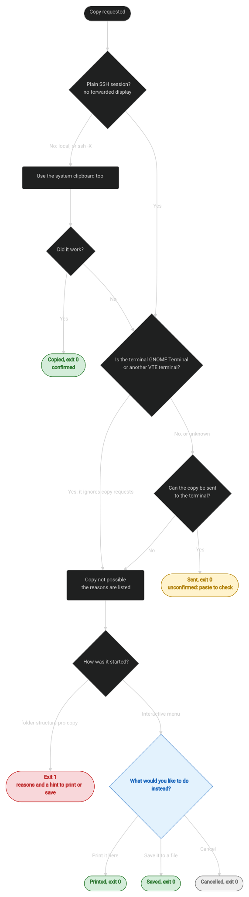

# Folder Structure Pro CLI

**Generate, copy, export, and recreate project folder structures from your terminal.**

[](https://www.npmjs.com/package/folder-structure-pro)
[](https://www.npmjs.com/package/folder-structure-pro)
[](https://github.com/ShreyPurohit/folder-structure-pro-vscode/actions/workflows/ci.yml)
[](./LICENSE)

Folder Structure Pro is a command-line folder structure generator and directory tree tool for developers. Scan a project to generate a readable file and directory tree, copy it to your clipboard, export it as text or JSON, or recreate directories and empty files from an existing structure.

It's useful for documenting projects, sharing directory structures with AI assistants, and reproducing project layouts without creating files and folders manually.

Use the interactive menu or run commands directly from your terminal.

## Features

- **Interactive mode** – Choose an operation through a guided terminal menu.
- **Copy** – Send a folder structure directly to your clipboard.
- **Export** – Save a structure as a text or JSON file, or print it to standard output.
- **Create** – Recreate directories and empty files from clipboard content, editor input, a file, or standard input.
- **Flexible filtering** – Exclude patterns, include hidden entries, and respect `.gitignore`.
- **Depth control** – Limit how many directory levels are included.
- **SSH support** – Copy from a remote server to your local clipboard through supported terminals.
- **Safe creation** – Preview changes, handle conflicts, and roll back changes if creation fails.
- **No runtime dependencies** – No extra packages are required at runtime.



## Requirements

- Node.js `>=22.14.0`

## Installation

### Run without installing

Try the CLI directly with a package runner:

```bash
npx folder-structure-pro
```

Or with pnpm:

```bash
pnpm dlx folder-structure-pro
```

### Install globally

**npm**

```bash
npm install -g folder-structure-pro
```

**pnpm**

```bash
pnpm add -g folder-structure-pro
```

Then run:

```bash
folder-structure-pro
```

## Quick Start

Copy the current project's folder structure:

```bash
folder-structure-pro copy
```

Export it as a text file:

```bash
folder-structure-pro export . --output folder-structure.txt
```

Recreate a structure from an exported file:

```bash
folder-structure-pro create structure.txt --to ./new-project --yes
```

Or run `folder-structure-pro` without arguments and choose an operation from the interactive menu.

The destination directory for `create` must already exist.

## How It Works

The CLI supports both guided interactive operations and direct commands.



## Commands

### Interactive Mode

Run the CLI without arguments:

```bash
folder-structure-pro
```

Choose between copying or exporting a folder structure and creating directories and empty files. The CLI guides you through the required inputs and shows a preview before completing the operation.

Press `Esc` or `Ctrl+C` at any prompt to cancel.

> Interactive mode requires a terminal that supports prompts. In scripts and non-interactive environments, use an explicit command.

### Copy a Folder Structure

```bash
folder-structure-pro copy [directory] [options]
```

Examples:

```bash
# Copy the current directory
folder-structure-pro copy

# Copy a specific directory
folder-structure-pro copy ./src

# Copy as JSON
folder-structure-pro copy . --format json

# Limit depth and exclude folders
folder-structure-pro copy . --depth 3 --exclude dist --exclude coverage
```

The directory defaults to the current working directory.

If copying is unavailable in your environment, see [Clipboard and SSH](#clipboard-and-ssh).

### Export a Folder Structure

Save the generated structure to a file or print it to standard output.

```bash
folder-structure-pro export [directory] --output <file|->
```

Examples:

```bash
# Export to a text file
folder-structure-pro export . --output folder-structure.txt

# Export as JSON
folder-structure-pro export . --format json --output structure.json

# Print to standard output
folder-structure-pro export . --output -

# Overwrite an existing regular file
folder-structure-pro export . --output folder-structure.txt --force
```

The output directory must already exist. Existing files are not overwritten unless you pass `--force`.

### Create a Folder Structure

Create directories and empty files from a text tree or JSON structure.

You can provide the structure in several ways:

| Input          | How it works                                                                              |
| -------------- | ----------------------------------------------------------------------------------------- |
| Clipboard      | Reads the structure you copied. Only available when the session can read the clipboard.   |
| Text editor    | Opens your editor so you can paste or write the structure, save it, and close the editor. |
| File           | Reads a previously saved structure.                                                       |
| Standard input | Reads piped content in a direct command.                                                  |

For editor input, the CLI uses `$VISUAL`, then `$EDITOR`, then the system default editor. It falls back to `nano` or `vi` where available, and Notepad on Windows.

After receiving the input, the CLI validates it and displays a preview. If it finds problems, it shows the relevant line numbers and text and can reopen the input for correction.



**Interactive usage**

Run `folder-structure-pro` and choose **Create directories and empty files**.

**Direct usage**

Pass a structure file or `-` for standard input:

```bash
folder-structure-pro create <structure-file|-> --yes [options]
```

Examples:

```bash
# Create from a text file
folder-structure-pro create structure.txt --to ./new-project --yes

# Read from standard input (macOS)
pbpaste | folder-structure-pro create - --to ./new-project --yes

# Read from standard input (Linux)
xclip -selection clipboard -o | folder-structure-pro create - --to ./new-project --yes

# Create from JSON and skip existing entries
folder-structure-pro create structure.json --format json --to . --yes --on-conflict skip
```

The destination defaults to the current working directory and must already exist.

Text input does not need a `Directory structure:` heading. Windows line endings are supported.

#### Handling existing entries

Use `--on-conflict` to control what happens when an entry already exists:

| Option           | Behavior                                                |
| ---------------- | ------------------------------------------------------- |
| `fail` (default) | Stop when conflicting entries are found.                |
| `skip`           | Keep existing entries and create the remaining entries. |
| `replace`        | Replace existing regular files with empty files.        |

Direct creation requires `--yes`. Replacing files requires both `--yes` and `--on-conflict replace`.

## Clipboard and SSH

Folder Structure Pro uses the clipboard tools available on your system. Over SSH, it can also send clipboard requests through supported terminals using OSC 52.



### Platform support

| Environment        | Clipboard behavior                                        |
| ------------------ | --------------------------------------------------------- |
| macOS              | Uses `pbcopy`.                                            |
| Windows            | Uses PowerShell, with `clip.exe` as a fallback.           |
| WSL                | Uses available Windows clipboard tools.                   |
| Linux with Wayland | Uses `wl-copy` when available.                            |
| Linux with X11     | Uses `xclip`, `xsel`, or Python 3 with GTK as a fallback. |
| SSH                | Uses OSC 52 when the terminal supports it.                |

On Linux desktops, install a clipboard utility if one is not already available. For example:

```bash
sudo apt install xclip
```

### SSH behavior

When copying over SSH, the CLI sends a clipboard request to your terminal. The copied content goes to your **local machine's clipboard**, not the server's clipboard.

Terminals do not confirm whether they accepted the request, so the CLI reports **Sent** rather than **Copied**. Paste once to verify.

Some terminal environments have limitations:

- **GNOME Terminal and other VTE-based terminals**, such as Tilix and Xfce Terminal, ignore OSC 52 clipboard requests. The CLI detects this and offers alternatives.
- **SSH with X forwarding** can work with `xclip` or `xsel` on the server because the display is forwarded to your desktop.
- **tmux** may require `set -g allow-passthrough on` in `~/.tmux.conf`.
- Clipboard requests larger than approximately 75 KB are not sent through the terminal because some terminals may drop long messages.

### If copying doesn't work

You can always print the structure and select it manually, or export it to a file:

```bash
# Print to the terminal
folder-structure-pro export . --output -

# Save to a file
folder-structure-pro export . --output folder-structure.txt
```

In interactive mode, the CLI offers these alternatives when copying fails.

## Command Options

### Copy and Export

| Option                  | Description                                             |
| ----------------------- | ------------------------------------------------------- |
| `--format <text\|json>` | Output format. Defaults to `text`.                      |
| `--depth <number>`      | Maximum directory depth. Unlimited when omitted.        |
| `--exclude <pattern>`   | Exclude matching files or directories. Can be repeated. |
| `--hidden`              | Include hidden files and directories.                   |
| `--no-gitignore`        | Disable root `.gitignore` filtering.                    |

### Export Only

| Option               | Description                                      |
| -------------------- | ------------------------------------------------ |
| `--output <file\|->` | Output destination. Use `-` for standard output. |
| `--force`            | Allow overwriting an existing regular file.      |

### Create Only

| Option                                | Description                                                       |
| ------------------------------------- | ----------------------------------------------------------------- |
| `--format <text\|json>`               | Input format. Detected automatically when omitted.                |
| `--to <directory>`                    | Destination directory. Defaults to the current working directory. |
| `--yes`                               | Confirm direct creation without an interactive prompt.            |
| `--on-conflict <fail\|skip\|replace>` | Conflict behavior. Defaults to `fail`.                            |

## Filtering Behavior

When scanning a directory, Folder Structure Pro applies these rules:

- `node_modules` is always excluded.
- Hidden files and directories are excluded by default.
- Root `.gitignore` rules are respected by default.
- Multiple `--exclude` patterns can be supplied.
- Directory symlinks are not traversed.
- A symbolic-link scan root is rejected.

Use `--hidden` to include hidden entries or `--no-gitignore` to disable root `.gitignore` filtering.

## Troubleshooting

| Problem                                              | What to do                                                                                  |
| ---------------------------------------------------- | ------------------------------------------------------------------------------------------- |
| Clipboard reports `Sent`, but pasting gives nothing. | Your terminal may have ignored the request. Try another supported terminal or use `export`. |
| GNOME Terminal cannot receive a clipboard copy.      | Print or export the structure, or use a terminal that supports OSC 52.                      |
| No clipboard tool found on Linux.                    | Install `xclip`, `xsel`, or `wl-clipboard`, depending on your desktop environment.          |
| This server has no desktop session.                  | This is normal over SSH. Use a supported terminal, `ssh -X`, or `export`.                   |
| No text editor found.                                | Set `EDITOR`, for example `export EDITOR=nano`, or provide a structure file.                |
| Nothing was entered after the editor closes.         | Your editor may return before the window closes. Try `EDITOR="code --wait"`.                |
| No terminal is available to send the copy to.        | Use `export --output <file>` or `export --output -`.                                        |

## Exit Codes

| Code | Meaning                                                                        |
| ---- | ------------------------------------------------------------------------------ |
| `0`  | Success, help, or interactive cancellation.                                    |
| `1`  | Execution, validation, filesystem, or clipboard failure.                       |
| `2`  | Invalid command or arguments, or non-interactive invocation without a command. |

## Limitations and Safety

- Only the root `.gitignore` is used. Nested ignore-file rules are not supported.
- Clipboard copies over SSH cannot be confirmed by the terminal.
- Export does not create missing parent directories.
- The destination directory for `create` must already exist.
- A plain root line without a tree connector, such as `proj/`, is skipped and its contents are created directly in the destination. A line with a connector, such as `└── proj/`, creates the `proj` directory. The preview shows exactly what will be created.
- Creation is all or nothing. If a step fails, or you press `Ctrl+C` during creation, changes made by that run are rolled back and replaced files are restored.
- A power cut or forced process termination, such as `kill -9`, cannot be rolled back.
- Rollback only removes entries created by the current run and only removes empty directories. It never recursively deletes directories, so files added by someone else are kept.
- Existing directories, symlinks, and entries with unknown metadata are never replaced during creation.
- Filesystem checks cannot eliminate every possible race involving concurrent path changes.

## Contributing

Contributions are welcome! You can report bugs, suggest features, improve documentation, or submit code.

Before contributing, read the [Contributing Guide](https://github.com/ShreyPurohit/folder-structure-pro-vscode/blob/main/CONTRIBUTING.md) for development setup, testing instructions, and the pull request process.

- [Report a bug](https://github.com/ShreyPurohit/folder-structure-pro-vscode/issues)
- [Start a discussion](https://github.com/ShreyPurohit/folder-structure-pro-vscode/discussions)
- [View the Contributing Guide](https://github.com/ShreyPurohit/folder-structure-pro-vscode/blob/main/CONTRIBUTING.md)

## License

[MIT](LICENSE) © Shrey Purohit

---

If Folder Structure Pro saves you time, consider giving the project a star on [GitHub](https://github.com/ShreyPurohit/folder-structure-pro-vscode).
